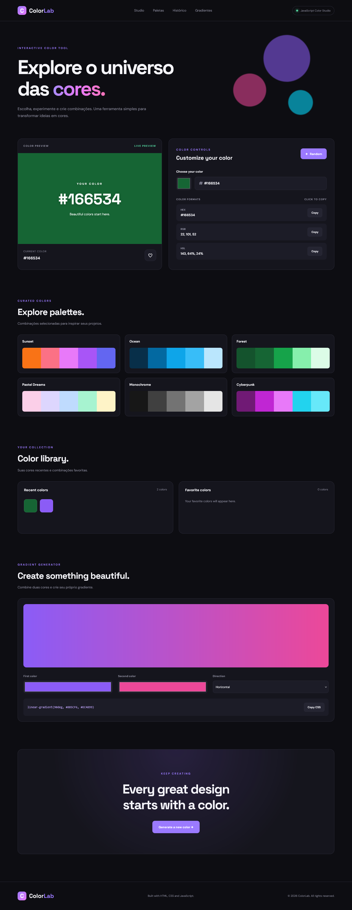

# ColorLab - Interactive Color Studio

ColorLab is an interactive color exploration tool developed with HTML5, CSS3, and Vanilla JavaScript.

The project allows users to explore colors, generate random palettes, convert color formats, save favorites, and create custom CSS gradients through a modern and responsive interface.

---

## Preview

<!-- Add your project screenshot here -->

<div align="center">

  

  **ColorLab - Interactive Color Studio**

  Explore colors. Create combinations. Build something beautiful.

</div>

---

## Features

### Color Selection
- Custom color picker.
- Manual HEX color input.
- Real-time color preview.
- HEX, RGB, and HSL conversion.

### Color Generator
- Random color generation.
- Predefined color palettes.
- One-click color selection.

### Color Management
- Recent color history.
- Favorite color collection.
- Persistent storage using LocalStorage.
- Remove colors from collections.

### Gradient Generator
- Two-color gradient creation.
- Custom gradient directions.
- Live gradient preview.
- CSS gradient code generation.

### Additional Features
- Copy color codes to clipboard.
- Copy generated CSS gradients.
- Responsive interface.
- Dark-themed design.
- Toast notifications.

---

## Technologies

| Technology | Purpose |
|---|---|
| HTML5 | Semantic page structure |
| CSS3 | Styling and responsive layout |
| JavaScript | Application logic and interactivity |
| LocalStorage | Persistent local data storage |
| Clipboard API | Copy color codes |

No frameworks or external JavaScript libraries are required.

---

## Project Structure

```text
ColorLab-JavaScript/
│
├── index.html
├── README.md
│
└── assets/
    ├── css/
    │   └── style.css
    │
    └── js/
        └── app.js
```

---

## Getting Started

### Requirements

- A modern web browser.
- Visual Studio Code or another code editor.
- Live Server extension (recommended).

### Installation

Clone the repository:

```bash
git clone https://github.com/Taunt-byte/ColorLab-JavaScript.git
```

Navigate to the project directory:

```bash
cd ColorLab-JavaScript
```

Open the project in Visual Studio Code:

```bash
code .
```

Run `index.html` using Live Server.

---

## How It Works

### Color Conversion

ColorLab converts hexadecimal colors into RGB and HSL formats using JavaScript functions.

### LocalStorage

The application uses the browser's LocalStorage API to preserve:

- Recently selected colors.
- Favorite colors.

This means the collections remain available after refreshing the page, as long as the browser data is not cleared.

### Gradient Generation

Users can select two colors and a direction to generate a CSS linear gradient.

The generated CSS can be copied and reused in other web development projects.

---

## Learning Objectives

This project was developed to practice and improve JavaScript skills, including:

- DOM manipulation.
- Event listeners.
- Functions and reusable logic.
- Arrays and objects.
- Array methods such as `map`, `filter`, and `includes`.
- Color conversion algorithms.
- LocalStorage.
- Clipboard API.
- Form and input validation.
- Dynamic interface rendering.
- Responsive web development.

---

## Future Improvements

- [ ] Export color palettes as JSON.
- [ ] Generate complementary colors.
- [ ] Add analogous and triadic color schemes.
- [ ] Implement accessibility contrast checking.
- [ ] Add gradient history.
- [ ] Support more than two gradient colors.
- [ ] Add palette import and export.

---

## Author

Developed as a JavaScript learning and portfolio project.

**GitHub:** [Taunt-byte](https://github.com/Taunt-byte)

**Technologies:** HTML5 | CSS3 | JavaScript

---

## License

This project is available for educational and personal portfolio purposes.
